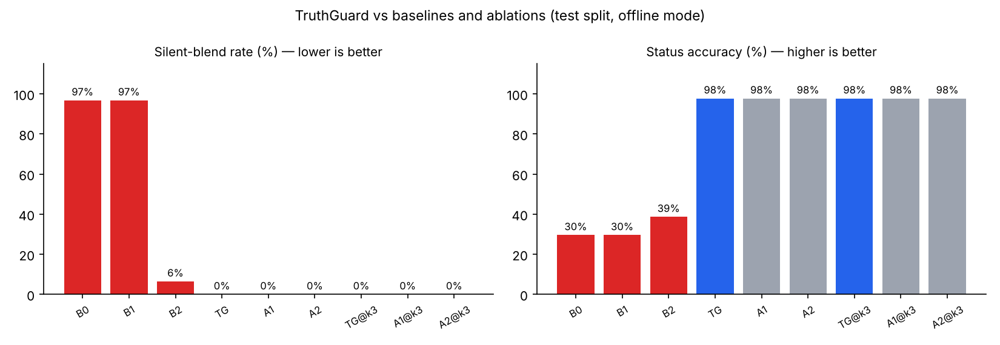

# TruthGuard

**Adversarial verification for multi-agent document Q&A over inconsistent corpora.** Built for the Virtusa Jatayu Agentic AI ideathon (problem statement 2).

Enterprise knowledge bases contradict themselves. They hold old policy versions, stale FAQs, partial amendments and memos that quietly "update" official rules. A normal RAG bot reads whichever passage ranks highest and answers confidently. TruthGuard instead **detects** the disagreement, **decides** which source applies using auditable precedence rules, and is **transparent**: it shows the losing source and the rule chain, or says plainly that the corpus cannot decide and who should.

Every answer ends in exactly one state:

| Status | Meaning |
| --- | --- |
| `VERIFIED` | All claims supported, sources agree. |
| `RESOLVED_CONFLICT` | Sources disagree; a precedence rule decides. The answer shows the losing sources and the rule chain. |
| `UNRESOLVED_CONFLICT` | Sources disagree and no rule decides. The answer shows every position with provenance and says who should settle it. |
| `INSUFFICIENT_EVIDENCE` | The corpus does not answer. TruthGuard abstains and says what is missing. |



## Results (frozen test split, 44 questions)

| Run | Silent-blend ↓ | Conflict F1 ↑ | Correct winner **and** rule ↑ | Status accuracy ↑ | Stale citations ↓ | p50 latency |
| --- | --- | --- | --- | --- | --- | --- |
| B0 naive RAG | 96.8% | 0.00 | 0% | 29.5% | 41.0% | 0.7 ms |
| B1 RAG + recency | 96.8% | 0.00 | 0% | 29.5% | 15.4% | 0.6 ms |
| B2 self-critique | 6.5% | 0.97 | 0% | 38.6% | 59.0% | 0.6 ms |
| **TruthGuard** | **0.0%** | **0.98** | **96.2%** | **97.7%** | **0.0%** | 72 ms |

Lineage expansion matters when retrieval is tight. At a 3-chunk rerank budget it lifts winner recall from 82% to 100%, and "every version of the conflict in evidence" from 68% to 96%. Full report, ablations and failure cases: [`eval/reports/results.md`](eval/reports/results.md). Dev-split report: [`eval/reports/dev/results.md`](eval/reports/dev/results.md).

> **How to read these numbers.** They were produced in **offline mode**: deterministic agents, and *deterministic proxies* of naive-RAG baselines (top-ranked value, newest value, "sources differ" with no rules). This repository has not been run against real LLM providers, so there are no live-LLM numbers yet. `LLM_MODE=live make eval` with API keys produces them, including ablations A3 (LLM picks the winner) and A4 (same-model critic). See [Limitations](#limitations).

## Five differentiators

1. **Conflicts as structured data.** At ingest, every passage becomes (subject, attribute, scope, value) slots with verbatim quote spans. A conflict is one slot holding two values, so detection is exact code. Normalization makes "1.5%", "1.50%" and "one and a half percent" the same value.
2. **Document lineage graph.** Supersedes and amends edges come from metadata *and* from text ("in partial modification of …, clause 4.2 is amended"), and they are scoped to the clause they amend. Retrieval always pulls the other versions in.
3. **Deterministic resolver.** R0 temporal validity → R1 explicit supersession → R2 authority tier (a newer lower-tier source escalates as a *possible unofficial update*) → R3 specificity → R4 recency in series → R5 unresolved. The order is configurable in `precedence.yaml`, and no LLM picks a side.
4. **A critic that actually attacks.** It runs in an independent context and makes seven checks: verbatim span integrity, entailment, staleness, blend detection, its own counter-searches, conflict coverage and unsupported claims. Objections drive a revision loop or re-analysis.
5. **Measured proof.** A seeded synthetic bank corpus with ground truth: 42 documents in 5 formats, 32 planted conflicts covering all 11 planted cases, and 151 gold questions with a frozen test split. Includes baselines, ablations and a retrieval-budget sweep.

Plus **Corpus Health**: every contradiction in the knowledge base, a topic × document heatmap, stale documents that are still searchable, "retire this FAQ" suggestions and a downloadable report.

## Quick start

**Docker (recommended):**

```bash
cp .env.example .env      # optional: add LLM keys; without keys everything runs offline
make up                   # Postgres+pgvector, API :8000, UI :3000; seeds the sample corpus
open http://localhost:3000
```

**Without Docker** (Python 3.12, Node 22, `uv`):

```bash
make install
make api      # terminal 1: SQLite, auto-seeds the corpus
make web      # terminal 2
```

**Demo day:** `make demo`, then follow [`docs/DEMO.md`](docs/DEMO.md). `make preflight` prints GREEN or RED.

**CLI:**

```bash
cd backend && .venv/bin/truthguard ask "What is the late fee on the Platinum card?"
# [RESOLVED_CONFLICT] The late payment fee for the Platinum Credit Card is ₹950. 4 conflicting sources were set aside by rule R1, R2.
.venv/bin/truthguard audit
```

## The UI

| Screen | Showstopper features |
| --- | --- |
| **Ask** | Status banner; claims with verified citations; conflict cards with rule chains; **split screen vs naive RAG** with a red overlay on stale or blended values; **debate theatre** (agent graph animating over SSE, critic checks, objection cards, revision diff); **evidence X-ray** (source opens at the highlighted span, with a SUPERSEDED stamp); **time-travel slider** (deterministic re-resolve, a few ms); **trust meter** and **cost ticker**; **injection badge**; **Challenge Mode** (a judge plants a contradiction live). |
| **Corpus Health** | Totals, topic × document severity heatmap, every contradiction, stale documents still live, recommended actions, Markdown report download. |
| **Lineage** | Versions of each series on a time axis; superseded versions greyed; edges labelled with relation, clause and confidence. |
| **Policy** | Reorder rules, toggle R2 escalation and cross-series recency, edit tiers, and compare saved vs draft policy on a past question (**live policy edit**). |
| **Traces** | Every query is replayable node by node, with tokens, cost and latency per node. |
| **Eval** | Live results from `eval/reports/results.json`. |

Dark mode, keyboard navigation (skip link, focus rings, Escape closes drawers) and responsive layouts are built in.

## Architecture

See [`docs/ARCHITECTURE.md`](docs/ARCHITECTURE.md) (diagram, data flow, API, safety, scaling path) and the decision records in [`docs/adr/`](docs/adr). The spec this was built from is in [`docs/SPEC.md`](docs/SPEC.md).

```
backend/   FastAPI + agents (Python 3.12, Pydantic v2, SQLAlchemy 2 async, Alembic)
frontend/  Next.js 15 + TypeScript + Tailwind 4 + TanStack Query, Playwright e2e
eval/      corpus generator, gold questions, runners, reports
data/      the generated Northwind Bank sample corpus + manifest.json (ground truth)
```

| Concern | Choice |
| --- | --- |
| LLM access | One `LLMGateway`: Pydantic-validated JSON, one repair retry then fail closed, timeouts, backoff, provider fallback (Groq → Gemini → Ollama), circuit breakers, response cache (dev, eval and demo replay), per-node token and cost accounting. |
| Models by role | Set per role in env (`PLANNER_MODEL`, `SYNTH_MODEL`, `CRITIC_MODEL`, `EXTRACT_MODEL`). The critic uses a different family from the synthesizer. |
| Storage | PostgreSQL 16 + pgvector (HNSW) via Alembic; SQLite for tests. |
| Retrieval | Dense + BM25 → RRF (k=60) → rerank to 12 → MMR across series → mandatory lineage expansion. |
| Defaults that need no GPU and no downloads | Feature-hashed embeddings, a lexical cross-scorer and a heuristic NLI, each with a drop-in model upgrade (`pip install -e "backend[models]"`). |
| Observability | structlog JSON logs, Prometheus `/metrics`, a trace ID per query with per-node latency, tokens and cost. |

## Quality

| Check | Command | Status |
| --- | --- | --- |
| Backend tests (unit, integration, Hypothesis property tests, API, critic loop with a fake LLM) | `make test` | 93 passed without a database server; 94 with the PostgreSQL/pgvector test (`make test-pg`) |
| Coverage | `make test` | 90% overall; `resolution/` 96–98%, `verification/` 89–95% |
| Lint / format | `make lint` | ruff and ESLint clean |
| Types | `make typecheck` | `mypy --strict` and `tsc --strict` clean |
| E2E: the demo script | `make e2e` | 6/6 Playwright tests |
| Corpus reproducibility | CI | Generator output is byte-identical (MD, DOCX, PDF, HTML, TXT) |
| CI | `.github/workflows/ci.yml` | Lint, types, tests on Postgres, migrations up/down, build, e2e; no API keys needed |

## Configuration

All settings come from the environment (see [`.env.example`](.env.example)). The important ones:

| Variable | Default | Meaning |
| --- | --- | --- |
| `LLM_MODE` | `offline` | `offline` = deterministic agents; `live` = real providers with deterministic fallback; `replay` = cached responses only |
| `GROQ_API_KEY`, `GEMINI_API_KEY`, `OPENAI_API_KEY`, `ANTHROPIC_API_KEY`, `OLLAMA_BASE_URL` | — | Providers in the fallback chain |
| `DATABASE_URL` | SQLite file | `postgresql+asyncpg://…` in compose |
| `VECTOR_BACKEND` | `numpy` | `pgvector` uses the HNSW index |
| `TODAY_OVERRIDE` | — | Pin "today" for reproducible demos and eval |
| `DEMO_MODE` | `false` | Warm caches for the scripted questions at startup |
| `API_KEY` | — | Require an `X-API-Key` header on `/v1/*` |

## Limitations

These are the things we'd tell a judge before they find them:

- **No live-LLM numbers yet.** The LLM paths (planner, extractor, synthesizer, critic judge, finalizer phrasing, baselines, ablations A3/A4) are implemented and tested against fake providers, including a full reject-and-revise loop. They have not been run against real providers in this repository. The headline numbers are offline.
- **The lexicon is written by the same author as the questions.** In offline mode, slots come from `lexicon.yaml`, and the corpus, questions and lexicon share an author, so offline accuracy overstates robustness to unseen phrasings. One frozen test question ("Within how many working days are savings account closure requests processed?") fails exactly this way: the planner maps no attribute, so TruthGuard abstains. We tuned only on the dev split and left this failure in. Mitigations: the LLM planner and extractor, and an LLM paraphrase pass over the corpus.
- **Synthetic corpus.** 42 fictional documents. Real public corpora (e.g. RBI master directions that list what they supersede, or WikiContradict and ConflictBank) are the next step.
- **Retrieval budget.** At k=3, resolution accuracy drops from 96% to 92% and 2.6% of answers cite a stale source. At the default k=12 on this corpus, retrieval is not the bottleneck.
- **Out of scope**, as the spec allows: OCR, non-English documents, real auth and multi-tenancy (an API-key stub only), write-back to source systems. Ingest jobs run in-process (no Redis), so they do not survive an API restart (ADR 0007).

## Roadmap

SharePoint and Confluence connectors; a review queue where policy owners settle unresolved conflicts (Corpus Health already names the owner); owner alerts when a new document creates a conflict; live-LLM eval with judge agreement on 30 hand-checked items; calibration of the confidence weights on the dev split with a reliability diagram.
