# TruthGuard architecture

TruthGuard answers questions over a deliberately inconsistent knowledge base. It detects disagreement between sources, decides which source applies using deterministic rules, and discloses the conflict instead of blending sources into one confident answer.

The expensive reasoning happens once, at ingest. Ingest extracts metadata, lineage and assertions. Query time is then mostly lookups, code-level checks and (in live mode) two or three LLM calls.

```mermaid
flowchart LR
  subgraph Ingest["Ingest path (per document, idempotent by SHA-256)"]
    P[Parse<br/>md · txt · html · docx · pdf] --> M[Metadata<br/>explicit → inferred, with provenance]
    M --> L[Lineage statements<br/>supersedes · amends clause · clarifies]
    L --> C[Section chunks<br/>+ injection detector]
    C --> I[Index<br/>dense + BM25]
    I --> A[Assertions<br/>subject · attribute · scope · value · quote]
    A --> F[Finalize: resolve edge targets,<br/>series, corpus audit]
  end
  subgraph Store["PostgreSQL + pgvector (SQLite in tests)"]
    DB[(documents · chunks · edges ·<br/>assertions · audit · traces · policy)]
  end
  F --> DB
  DB --> S[In-memory CorpusSnapshot]
  subgraph Query["Query path (agent graph, streamed over SSE)"]
    Q1[Planner] --> Q2[Retriever<br/>hybrid · RRF · rerank ·<br/>lineage expansion]
    Q2 --> Q3[Analyst<br/>slots + typed conflicts]
    Q3 --> Q4[Resolver<br/>R0–R5, code only]
    Q4 --> Q5[Synthesizer<br/>atomic cited claims]
    Q5 --> Q6[Critic<br/>7 checks + counter-search]
    Q6 -- revise --> Q5
    Q6 -- NEW_CONFLICT --> Q3
    Q6 --> Q7[Finalizer<br/>status · confidence]
  end
  S --> Q2
  Q6 -. counter-retrieval .-> Q2
```

## Repository map

| Path | What lives there |
| --- | --- |
| `backend/src/truthguard/domain` | Pydantic models and enums (no I/O) |
| `backend/src/truthguard/llm` | `LLMGateway` (structured output, repair retry, fail closed, fallback chain, circuit breakers, cache, cost), providers, versioned prompt loader |
| `backend/src/truthguard/prompts` | Versioned prompt files (`<name>.v<N>.md`) |
| `backend/src/truthguard/ingestion` | parse, metadata, lineage, chunk, injection, normalize, lexicon, assertions, pipeline |
| `backend/src/truthguard/retrieval` | corpus snapshot, hashing embedder, BM25, RRF, rerank, dense backends (numpy / pgvector), retriever |
| `backend/src/truthguard/resolution` | `precedence.yaml`, policy model, rule engine, conflict detection |
| `backend/src/truthguard/verification` | span check, NLI, staleness, blend detector |
| `backend/src/truthguard/agents` | planner, analyst, synthesizer, critic, finalizer, baselines |
| `backend/src/truthguard/orchestration` | the agent graph and routing |
| `backend/src/truthguard/services` | the application container (wiring) and Corpus Health |
| `backend/src/truthguard/api` | FastAPI app, SSE, schemas |
| `frontend/` | Next.js UI (Ask, Corpus Health, Lineage, Policy, Traces, Eval) and Playwright e2e |
| `eval/` | corpus generator, gold datasets, runners, reports |

## Ingest

1. **Parse** (`parse.py`). Each format becomes blocks (heading, bullet, paragraph), rendered to one canonical `raw_text`. Section and chunk offsets index into it, so every quote can be verified verbatim. PDF headings come from font size; DOCX headings from paragraph styles.
2. **Metadata** (`metadata.py`). Sources are tried in this order: frontmatter, DOCX core properties and HTML meta tags (explicit, 1.0); filename patterns (`_v2_2024-03`, explicit, 0.8); header lines such as "Effective from: …" (inferred, 0.9); title keywords and "with effect from" (inferred, 0.6–0.7); then the LLM in live mode. Each field keeps its provenance and confidence, and inferred values never outrank explicit ones. The authority tier comes from the document type via `precedence.yaml`.
3. **Lineage** (`lineage.py`). Regex patterns find statements such as "supersedes", "replaces", "in partial modification of …, clause 4.2 is amended" and "supplements". Targets are matched corpus-wide on title tokens plus version or date, so ingest order does not matter. An edge from an undated source gets lower confidence (0.72 vs 0.9). Series are assigned by union-find over explicit series hints, equal title keys and supersession edges.
4. **Chunk** (`chunk.py`). One chunk per section; long sections are split into ~600-token windows with 15% overlap. A prompt-injection detector flags chunks.
5. **Index**. Feature-hashed embeddings (384-d), stored in a pgvector column with an HNSW index, plus BM25 over title, heading path and text.
6. **Assertions** (`assertions.py`). Each clause becomes slot tuples (subject, attribute, scope, value) carrying a normalized value, modality, effective window and verbatim quote span. When a clause names no attribute, it inherits one from its heading ("4.2 Late Payment Fee" → bullet "Platinum Credit Card: ₹750"). Assertions from flagged chunks are marked `quarantined`.
7. **Audit** (`pipeline.finalize`). All assertions are grouped by slot; every slot with disagreeing values becomes a typed `ConflictSet`, which is resolved as of today and stored. This feeds Corpus Health.

## Query

1. **Planner.** Maps the question to registry slots, scopes and an as-of date. Unknown products ("Titanium card", "home loan") are reported, not mapped to a near neighbour; that is what makes abstention work.
2. **Retriever.** Dense top-40 and BM25 top-40 for the question and each slot sub-query, fused with RRF (k=60) and reranked to 12, with an MMR-style penalty per series. **Lineage expansion** then pulls the matching section from series siblings and lineage neighbours. Pre-extracted assertions are attached, and each item is marked active, superseded, not yet effective or quarantined at the as-of date.
3. **Analyst.** Groups assertions into the plan's slots, filters by scope overlap and emits a typed conflict (value mismatch, temporal supersession, authority clash, scope overlap, modality conflict or numeric drift). It never judges.
4. **Resolver** (code only, `resolution/engine.py`). Applies Q, then R0–R5 in policy order. Each eliminated assertion records the rule that removed it, and every evaluated rule is logged with a note. See ADR 0006.
5. **Synthesizer.** Writes atomic claims that follow the resolutions. Each claim has a verdict (`winner`, `position`, `superseded`) and quoted citations. Live mode uses the strongest model; offline mode and re-resolve use a deterministic writer.
6. **Critic.** Runs in an independent context with its own corpus access. Checks:
   - span integrity (quote verbatim in its chunk, in code)
   - entailment (NLI; gray zone goes to an LLM judge in live mode)
   - staleness (superseding edge in force at the as-of date)
   - blend detection (a value matching no single source, or only an eliminated one)
   - counter-retrieval (4 adversarial queries per slot; a new assertion raises `NEW_CONFLICT`)
   - coverage (every conflict disclosed; unresolved ones with ≥2 positions)
   - unsupported claims
7. **Routing.** With no blocking objection the graph finalizes. `NEW_CONFLICT` adds the counter-retrieved evidence and re-runs analyst and resolver. Other blocking objections send the draft back for revision with the objections attached. The loop stops after at most 2 rounds, or as soon as blocking objections stop decreasing.
8. **Finalizer.** Sets the status: any unresolved slot means `UNRESOLVED_CONFLICT`; any decided conflict means `RESOLVED_CONFLICT`; otherwise `VERIFIED`; nothing answerable means `INSUFFICIENT_EVIDENCE`. A residual critical objection forces abstention (fail closed). Confidence combines retrieval coverage, weakest entailment, resolution strength, an inferred-metadata penalty and residual objections.

**Re-resolve** (`POST /v1/traces/{id}/re-resolve`) re-runs analyst, resolver, the deterministic writer, the code-only critic checks and the finalizer on the stored evidence, with a new as-of date or policy. There is no LLM call and no retrieval, so it takes a few milliseconds. This powers the time-travel slider and the live policy edit.

## API

| Method | Path | Purpose |
| --- | --- | --- |
| POST | `/v1/documents` | Upload files → ingest job id (202) |
| POST | `/v1/documents/quick` | Challenge Mode: one short document, synchronous, with stage timings |
| GET | `/v1/jobs/{id}` | Ingest progress by stage |
| GET | `/v1/documents`, `/v1/documents/{id}`, `/v1/documents/{id}/lineage`, `/v1/lineage` | Documents, raw text for X-ray, lineage timelines |
| POST | `/v1/query` | SSE stream: `plan.created`, `retrieval.completed`, `evidence.analyzed`, `conflict.detected`, `resolution.applied`, `draft.created`, `critic.objection`, `critic.completed`, `revision.started`, `answer.final`, `error` (mode `truthguard`, `B0`, `B1`, `B2`) |
| POST | `/v1/query/sync` | The same, returned as JSON |
| GET | `/v1/traces`, `/v1/traces/{id}` | Replay a past query node by node |
| POST | `/v1/traces/{id}/re-resolve` | New as-of date and/or policy override; resolver + finalizer only |
| GET | `/v1/conflicts`, `/v1/conflicts/report.md` | Corpus Health (filter by topic, severity), downloadable report |
| GET, PUT | `/v1/policy/precedence` (+ `/reset`) | View and edit precedence rules |
| POST | `/v1/admin/reset` | Demo reset: drop judge-added documents, restore the default policy |
| GET | `/healthz`, `/readyz`, `/metrics`, `/v1/meta`, `/v1/eval/results` | Liveness, readiness, Prometheus, config, eval report |

Every event carries trace id, node, timestamp, payload, tokens, cost and latency. `API_KEY` turns on an `X-API-Key` check. CORS is a strict allow-list, and uploads are limited by size and type.

## Safety

- **Documents are data.** Evidence is wrapped in delimited blocks, and prompts say to ignore instructions inside them. The injection detector quarantines chunks, the resolver excludes quarantined assertions (rule Q) and the UI shows a badge. The corpus contains one planted injection.
- **Citations are checked in code** and are never trusted from a model.
- **Fail closed.** A schema failure gets one repair retry; after that the LLM path falls back to the deterministic one. A residual critical objection makes the answer abstain.
- **Resilience.** Per-call timeouts, exponential backoff, per-provider circuit breakers and a provider fallback chain.

## Scaling to ~10⁶ chunks

The API is stateless apart from the snapshot. At scale, switch to `VECTOR_BACKEND=pgvector` (HNSW) and Postgres full-text search or a BM25 extension for lexical search. Run ingest in workers that share the job table, and batch embedding. The corpus audit is per slot and parallelizes trivially. Assertion extraction is the main ingest cost in live mode; it is cached by content hash.
